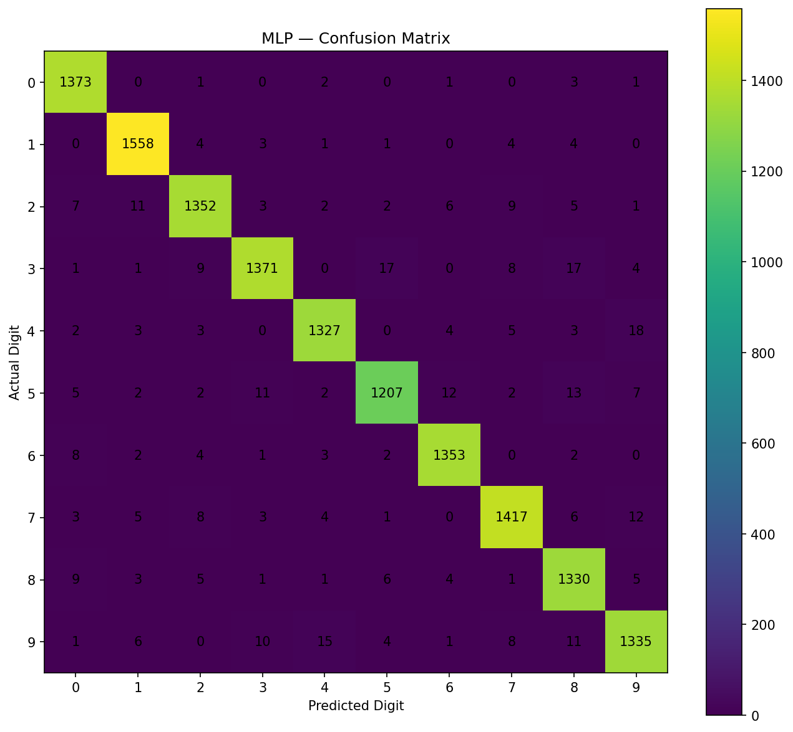

# Executed results

The complete original notebook was executed with the pinned requirements and
Python 3.11.7. No original cell was removed or edited. The source SHA-256 is:

```text
4589961d3bf59aaac3859efc95184b344f8c27112cd102f30fda12c2dad8483c
```

## Validation-based model selection

| Model | Best validation accuracy |
| --- | ---: |
| KNN | 97.2286% |
| Random Forest | 96.8000% |
| MLP | **97.4571%** |

The export command selected **MLP** immediately after all tuning tables became
available, before the original final-training and test-evaluation cells ran.
The selected parameters are one hidden layer with 64 neurons and an initial
learning rate of 0.001. The original MLP settings include `max_iter=40`,
`early_stopping=True`, `n_iter_no_change=5`, `validation_fraction=0.1`, and
`random_state=42`.

## Independent test results

All final classifiers were evaluated on the same 14,000-image test subset:

| Model | Accuracy | Weighted precision | Weighted recall | Weighted F1 |
| --- | ---: | ---: | ---: | ---: |
| KNN | 0.973214 | 0.973408 | 0.973214 | 0.973185 |
| MLP (API) | 0.973071 | 0.973105 | 0.973071 | 0.973047 |
| Random Forest | 0.968143 | 0.968142 | 0.968143 | 0.968122 |

The API model achieved **97.3071% accuracy**. KNN's test accuracy was higher
by two correct predictions, but this did not change the API choice: validation
had already selected MLP. The original notebook still independently selects
KNN for its historical best-model, error-analysis, and masked-class experiments.

The weighted averages account for class support. In this single-label multiclass
evaluation, weighted recall equals accuracy; these are not two independent
indications of quality.



Rows are true digits and columns are predicted digits. Off-diagonal counts are
classification errors. This figure was produced by the unchanged notebook in
the new execution.

## Computational cost

| Model | Final fit (seconds) | Inference on all 14,000 test images (seconds) |
| --- | ---: | ---: |
| KNN | 0.058566 | 14.597241 |
| MLP | 20.154101 | 0.033854 |
| Random Forest | 18.918212 | 0.381045 |

These are batch timings from one machine and execution, not HTTP latency
measurements. They vary with hardware, BLAS implementation, parallelism, and
system load. KNN's short fit time does not measure all of its serving cost.

## Artifact and serving verification

- The saved pipeline includes the original float32 division by 255 and the
  fitted MLP, and occupies 572,697 bytes in this execution.
- After serialization, the pipeline was reloaded and reproduced the original
  MLP's predictions on **all 14,000 test images**.
- The included example is the first digit 7 in the test split. The API predicts
  7; its complete response is in `examples/expected_prediction.json`.
- Thirty integration tests passed, covering the real model, strict validation,
  output validation, HTTP errors, documentation, and lifecycle behavior.
- The load-count test confirms one disk load per application lifecycle across
  repeated health checks and predictions.
- A real Uvicorn process was started and checked over HTTP: health, Swagger,
  and the digit example returned 200; invalid input returned 422; a uniform
  image returned 400. The verification process was then stopped cleanly.
- `python -m pip check` reported no broken requirements.

## External images and OOD limitations

The original hidden-class experiment was also executed. It removes 4 and 9
from a separate KNN model's training data and shows how the remaining classes
can receive confident predictions for unseen digit classes. That masked model
is **not** the model saved for the API.

The supplied notebook retains historical outputs for nine photographs, with
four correct predictions according to their filenames. Those original photos
were not supplied, so the new execution correctly reports **zero custom images
processed**. It does not claim a new external-photograph accuracy result.

The API accepts already arranged MNIST-style pixel data. The original notebook
contains preprocessing for photographs, but this implementation does not add
a file-upload endpoint. Rejecting invalid pixel arrays and uniform images does
not provide a general non-digit or OOD detector.

The original notebook's saved outputs can differ slightly from a fresh run,
especially for floating-point neural-network training and timing. The exact
metrics and versions for the shipped artifact are recorded in
[`models/metadata.json`](../models/metadata.json).
